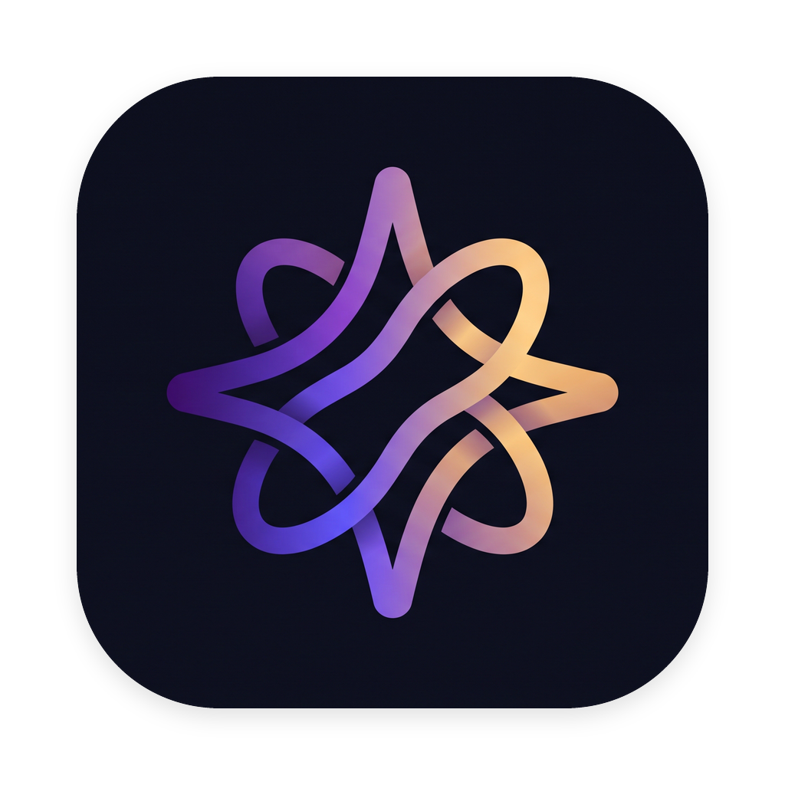

<p align="center">
  
</p>

<h1 align="center">Organizer</h1>

<p align="center">
  Notizen aus Obsidian, Apple Kalender, Aufgaben mit Deadlines und eine Roadmap – in einer Mac-App.<br>
  Lokal, ohne Server, ohne Cloud, ohne Account.
</p>

<p align="center">
  <a href="#download">Download</a> ·
  <a href="#funktionen">Funktionen</a> ·
  <a href="#erste-schritte">Erste Schritte</a> ·
  <a href="Docs/VAULT-FORMAT.md">Dateiformat</a> ·
  <a href="Docs/ENTWICKLUNG.md">Entwicklung</a> ·
  <a href="#english">English</a>
</p>

---

## Die Idee

Obsidian bleibt die einzige Quelle. Organizer liest und schreibt ganz normale Markdown-Dateien in deinem Vault –
alles, was die App anlegt, ist in Obsidian ohne Organizer lesbar und bearbeitbar. Dazu kommen deine Termine aus
dem Apple Kalender, Aufgaben mit Deadlines und eine Roadmap für Projekte, in einer Oberfläche, die sich wie eine
App von Apple anfühlt.

## Funktionen

- **Dashboard** – Termine heute und morgen, fällige Aufgaben, zuletzt bearbeitete Notizen, nächste Meilensteine.
- **Notizen** – der Ordnerbaum deines Vaults, Volltextsuche, Markdown-Vorschau, Bearbeiten mit automatischem Speichern,
  „In Obsidian öffnen“. Änderungen aus Obsidian erscheinen sofort.
- **Aufgaben** – jede Zeile `- [ ] …` im Vault, im Format des Obsidian-Plugins [Tasks](https://publish.obsidian.md/tasks/):
  Heute, Diese Woche, nach Bereich, Erledigt – als Liste oder als Board (Offen, In Arbeit, Erledigt).
  Abhaken, Datum, Priorität, Wiederholung, verlinkte Notizen (`[[Notiz]]`) – geändert wird immer genau eine Zeile. Wiederkehrende Aufgaben (🔁) bekommen
  beim Abhaken wie im Tasks-Plugin automatisch die nächste Wiederholung.
- **Kalender** – Tag, Woche, Monat aus dem Apple Kalender; Termine anlegen; fällige Aufgaben per Drag and Drop verschieben;
  Aufgaben in die Zeitleiste ziehen legt einen Zeitblock im Apple Kalender an.
- **Roadmap** – Projekte mit Meilensteinen als Zeitleiste, Fortschritt aus den Aufgaben.
- **Mac-Ordner pro Thema** – Projektordner vom Schreibtisch mit einem Thema verknüpfen.
- **Schnellerfassung** – mit ⌃⌥ Leertaste aus jeder App: „Hausarbeit bis Freitag #uni !!“ wird eine Aufgabe mit Datum,
  Bereich und Priorität.
- **Apple Erinnerungen** (optional) – Aufgaben mit Datum auch auf dem iPhone; Abhaken dort landet wieder im Markdown.
- **Menüleiste, Mitteilungen, Widgets** – heute auf einen Blick, Erinnerung am Fälligkeitstag.
- **Claude** (optional) – über [MCP](https://modelcontextprotocol.io) mit Claude Code oder Claude Desktop: Claude legt
  Notizen, Aufgaben und Termine an – über dein eigenes Claude-Abo, Organizer selbst bleibt offline.
- **Deutsch, English, العربية** – umschaltbar in den Einstellungen.

## Download

Die aktuelle Version gibt es unter [**Releases**](../../releases) als `Organizer-<Version>.dmg`.

**Voraussetzung:** macOS 26 oder neuer, Apple Silicon oder Intel.

1. DMG öffnen und **Organizer** auf **Programme** ziehen.
2. Beim ersten Start meldet macOS, dass Apple die App nicht überprüfen konnte – sie kommt nicht aus dem App Store.
   Öffnen trotzdem: **Systemeinstellungen › Datenschutz & Sicherheit › „Trotzdem öffnen“** (nur einmal nötig).

## Erste Schritte

1. **Vault wählen** – Ablage › Vault öffnen … (⇧⌘O). Jeder Ordner mit `.md`-Dateien funktioniert, auch ohne Obsidian.
2. **Bereiche** – Ordner auf oberster Ebene sind Bereiche (z. B. `Uni`, `Arbeit`), ihre Unterordner Themen.
3. **Kalender, Erinnerungen, Mitteilungen** – erlauben, wenn macOS fragt (alles optional).
4. **Sprache** – Einstellungen (⌘,) › Allgemein › Sprache.

Wichtige Tastenkürzel: ⌘1–⌘5 Bereiche · ⌘N neu · ⌘F suchen · ⌘E bearbeiten · ⌃⌥ Leertaste Schnellerfassung · ⌘Z rückgängig.

## Datenschutz

- Organizer arbeitet **vollständig lokal** und hat **keinen Internetzugang** (App-Sandbox ohne Netzwerkrecht).
- Zugriff nur auf Ordner, die du ausdrücklich auswählst, und – wenn du es erlaubst – auf Kalender und Erinnerungen.
- Keine Analyse, keine Telemetrie, kein Account.
- Die optionale Claude-Anbindung läuft über die Claude-App bzw. Claude Code mit deinem eigenen Konto; Organizer
  sendet selbst nichts.

## Dein Vault bleibt deiner

- Organizer überschreibt keine Dateien ungefragt und ändert bei Aufgaben immer nur die betroffene Zeile.
- Vor jedem Speichern wird geprüft, ob die Datei inzwischen in Obsidian geändert wurde – dann gewinnt nichts ungefragt.
- Fast alles lässt sich mit ⌘Z rückgängig machen.
- Das genaue Format (Frontmatter, Aufgaben, Roadmap, verknüpfte Ordner) steht in [Docs/VAULT-FORMAT.md](Docs/VAULT-FORMAT.md).

## Selbst bauen

Voraussetzungen: Xcode 27 (macOS 26 SDK).

```bash
git clone https://github.com/Pascal12892/Organizer.git
cd Organizer
open Organizer.xcodeproj                 # ⌘R in Xcode
Scripts/package-app.sh                   # DMG unter dist/
cd Packages/OrganizerCore && swift test  # Tests
```

Mehr dazu in [Docs/ENTWICKLUNG.md](Docs/ENTWICKLUNG.md).

## Lizenz

[MIT](LICENSE) © 2026 Pascal Lupo. Verwendete Open-Source-Komponenten: [THIRD-PARTY-NOTICES.md](THIRD-PARTY-NOTICES.md).

Organizer ist ein unabhängiges Projekt und steht in keiner Verbindung zu Obsidian, Apple oder Anthropic.

---

## English

**Organizer** is a local macOS app that brings your Obsidian notes, Apple Calendar, tasks with deadlines and a project
roadmap together in one place. Obsidian stays the single source of truth: Organizer reads and writes plain Markdown
files in your vault (tasks use the format of the Obsidian [Tasks](https://publish.obsidian.md/tasks/) plugin).
No server, no cloud, no account – and no network access at all.

- Download the DMG from [Releases](../../releases). Requires macOS 26 or later (Apple Silicon or Intel).
  On first launch, allow it via *System Settings › Privacy & Security › Open Anyway*, since it is not from the App Store.
- Choose your vault with *File › Open Vault …* (⇧⌘O). Switch the language to English in *Settings › General › Language*.
- Optional: sync tasks with Apple Reminders, connect Claude Code or Claude Desktop via MCP.

Licensed under the [MIT License](LICENSE).
